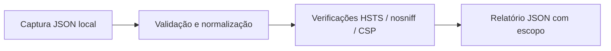

# Arquitetura e decisões

## Fluxo de dados

`audit` recebe um objeto e retorna as verificações. A CLI cuida apenas da leitura, serialização e códigos de saída. Não há cliente HTTP ou consulta de rede.

Nomes são normalizados para minúsculas; valores são texto sem quebras de linha. A representação atual não preserva cabeçalhos repetidos. Nomes que se repetem após normalização são rejeitados. A política completa e o comportamento real do navegador não são simulados.

## Estados do relatório

| Estado | Significado |
| --- | --- |
| `missing` | O cabeçalho não foi encontrado na captura |
| `review` | A configuração observada precisa de revisão |
| `basic_check_passed` | Apenas a condição básica daquela regra foi encontrada |
| `manual_review` | A presença foi reconhecida, mas a política não foi validada |
| `not_applicable` | A regra não se aplica ao esquema informado |

Uma captura com CSP presente não prova proteção contra XSS. Uma verificação básica de HSTS não comprova validade de todas as diretivas. Os resultados ajudam a orientar a revisão humana.

## Exemplos reproduzíveis

Compare [a captura](../examples/review.json) com [o relatório gerado](../examples/report.json). Os testes cobrem entradas ausentes, inválidas e ambíguas, além da CLI. Campos não analisados não são reproduzidos no relatório.
